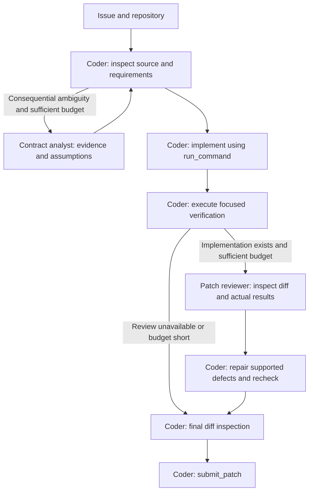

# Submission agent-system architectures

Updated 2026-10-20. This document records each submission's model, LoRA adapters, applied skills, agent roles, workflow, and differences from other versions. Configurations and packaged ZIPs establish the architecture; [submission_records.md](submission_records.md) supplies the latest reported public scores. Older candidate READMEs and build manifests may still describe a version as unmeasured.

**Models, adapters and scores**

The model names below refer to the exact variants configured for every agent in that submission:

- **31B:** `gemma-4-31b-it-qat-w4a16-ct`, the largest variant in the project's allowed-model list.
- **E2B:** `gemma-4-e2b-it-qat-w4a16-ct`, the smallest listed variant, used only by Submission 6.

| Submission | Model for all agents | LoRA adapters | Configured agents | Public score |
| --- | --- | --- | --- | ---: |
| [Starter ZIP](competition_material/submission.zip) | 31B | `main_lora` for coder; `tool_lora` for analyzer | 2: coder + code analyzer | 0.03 |
| [Submission 1](submission_nb/submission_1/agent.yaml) | 31B | None | 2: coder + code analyzer | 0.10 and 0.06 |
| [Submission 2](submission_nb/submission_2/agent.yaml) | 31B | None | 2: coder + code analyzer | 0.10 |
| [Submission 3](submission_nb/submission_3/agent.yaml) | 31B | None | 3: coder + code analyzer + patch reviewer | 0.12 |
| [Submission 4](submission_nb/submission_4/agent.yaml) | 31B | None | 3: coder + repository locator + test verifier | 0.12 |
| [Submission 5](submission_nb/submission_5/agent.yaml) | 31B | None | 3: coder + repository locator + test verifier | 0.06 |
| [Submission 6](submission_nb/submission_6/agent.yaml) | E2B | None | 2: coder + code analyzer | 0.03 |
| [Submission 7](submission_nb/submission_7/agent.yaml) | 31B | None | 3: coder + contract analyst + counterexample test designer | **0.13** |
| [Submission 8](submission_nb/submission_8/agent.yaml) | 31B | None | 3: coder + contract analyst + patch reviewer | 0.12 |

Submission 1 has two recorded results; neither is discarded or treated as an average. Submission 7 currently has the highest recorded public score. These observations alone do not isolate the effect of agent count, role design, prompts or runtime settings.

The starter's two LoRA adapters each declare rank `r=4`, `lora_alpha=8`, target modules `q_proj` and `o_proj`, dropout `0.0`, and task type `CAUSAL_LM`, against `google/gemma-4-31b-it-qat-w4a16-ct`. Their configuration does not establish training quality or a performance benefit.

Submissions 1–8 contain no `adapter:` declarations or adapter weight files in their ZIPs. The original sample assets are preserved under [reference_adapters](submission_nb/reference_adapters/README.md), outside the active submissions. Different agent roles in these versions come from instructions and tool access, using the same model variant within each submission.

**Applied skills**

The starter and Submissions 1–8 have **no configured skill packages**: their agent YAML files contain no `skills:` declarations, and their ZIPs contain no `SKILL.md` files or skill resources. Code navigation, contract analysis, test design and patch review are behaviors specified in the agent instruction files. Submission 8's Python editing recipe is embedded in its coder prompt. These behaviors do not add a separately packaged skill or custom runtime tool.

**How the agents work together**

Every version has one main coder that owns the implementation and patch submission. Helpers are exposed to the coder through `agent_tool` connections. The coder supplies a question, receives findings, and continues work. All helper connections use `skip_summarization: true`; Submissions 1–8 also set `include_contents: none` on helpers, so the coder must supply the necessary issue, source and test evidence in each request.

The configured agent count describes available roles. It does not guarantee every helper is invoked on every task. Delegation thresholds and “once per task” limits are prompt instructions; all roles consume the shared task resources.

| Version | Relationship and intended workflow |
| --- | --- |
| Starter | Coder inspects the repository → optionally asks the analyzer to locate a cause → coder edits, checks and submits. Each role has its own named sample adapter. |
| 1 | Coder performs direct inspection → optionally asks a focused navigation/root-cause question → analyzer returns source evidence → coder implements, tests, reviews and submits. |
| 2 | Same two-role workflow as 1, with stronger guidance to implement once the cause is supported, cover all requested behavior, shorten helper exploration and capture the patch before finishing. |
| 3 | Coder may consult the analyzer before editing → coder implements and tests → optionally asks the reviewer to examine the existing diff and results → coder repairs, rechecks and submits. |
| 4–5 | Coder may ask the locator where relevant implementation/tests live → coder edits → verifier may execute a focused behavioral check or diagnose a failure → coder repairs and submits. |
| 6 | Same workflow and prompts as 2, with E2B replacing 31B for both agents. |
| 7 | Coder inspects source → analyst may clarify the behavioral contract → coder implements → test designer may propose one discriminating check → coder validates and executes that proposal, repairs and submits. Both helpers have no tools. |
| 8 | Coder checks status and inspects source through shell commands → analyst may resolve contract ambiguity → coder implements and runs a check → reviewer examines the actual diff and observed results → coder repairs, rechecks and submits. Both helpers have no tools. |

Submission 8's workflow is:

**Tool access and role boundaries**

For comparison, the six basic coder tools are `run_command`, `read_file`, `edit_file`, `write_file`, `get_status` and `submit_patch`. The three graph/retrieval tools are `get_code_neighbors`, `search_similar_code` and `get_code_subgraph`.

| Version | Coder's direct tools, excluding helper connections | Helper tools |
| --- | --- | --- |
| Starter, 1, 2, 6 | Six basic tools + three graph/retrieval tools | Analyzer: `read_file` + three graph/retrieval tools |
| 3 | Six basic tools + three graph/retrieval tools | Analyzer: same as 2; reviewer: `read_file` only |
| 4–5 | Six basic tools | Locator and verifier: `run_command`, `read_file` |
| 7 | Six basic tools | Analyst and test designer: none |
| 8 | `run_command`, `get_status`, `submit_patch` | Analyst and reviewer: none |

In 4–5, helpers are instructed to leave implementation and environment changes to the coder, but `run_command` can technically write files. Their read-only role therefore depends on prompt compliance. In 7–8, empty helper tool lists remove direct repository execution from those roles; their advice depends entirely on the evidence supplied by the coder.

Submission 7's `counterexample_tester_agent` designs checks; the coder executes them. Submission 8's `patch_reviewer_agent` reviews an existing patch and observed outcomes; it cannot independently establish that a test passed. Submission 3's reviewer differs from Submission 8's reviewer because it can read source itself.

**What changed between versions**

| Version | Comparison | Concrete change and purpose |
| --- | --- | --- |
| 1 | From starter | Removes both sample adapters; revises coder/analyzer guidance; gives the analyzer a smaller output/thinking allocation; increases the task allowance from 1 minute/10 calls/50 turns to 4 minutes/40 calls/80 turns. |
| 2 | From 1 | Changes only the coder and analyzer instruction files. Models, tools, topology, sampling and budgets remain byte-identical. Focuses on complete implementation, concise delegation, verification and explicit submission. |
| 3 | From 2 | Adds a third agent for optional review of an existing patch. The coder retains edits and test execution. Review guidance skips delegation below 90 seconds or six counted calls remaining. |
| 4 | From 3 | Replaces the analyzer/reviewer pair with a shell-capable repository locator and executing test verifier. Removes graph/retrieval tools from the coder and helpers. |
| 5 | From 4 | Retains the architecture and prompts exactly. Changes only four files: the evaluation config and three sampling configs. Requests thinking off and raises `timeout_seconds` from 60 to 300. |
| 6 | From 2 | Changes only the two agent model declarations from 31B to E2B among active package files. Prompts, tools, sampling and task budgets remain byte-identical. |
| 7 | From 4's execution roles | Replaces tool-using helpers with a contract analyst and counterexample test designer. The revised package reduces the coder output ceiling to 8,192 and strengthens tool-argument recovery, scratch-file handling, contract coverage and patch capture. |
| 8 | From 7 | Removes `read_file`, `edit_file` and `write_file` from the coder; shell commands handle repository operations. Replaces the unused test designer with a reviewer of the actual diff/results. Grounds explicit requirements in issue quotations and makes review the normal checkpoint when budget permits. Sampling and task budgets remain byte-identical. |

For Submission 8, the analyst is requested for consequential ambiguity with at least 12 calls remaining, unless a known timer is below 120 seconds. Review normally occurs once an implementation exists, with at least six calls remaining, unless a known timer is below 60 seconds. If no timer is reported, the call thresholds apply. The coder falls back to its own inspection when review is unavailable or the budget is short.

**Sampling and task allowances**

All configurations use temperature `0.2` and top-p `0.95`. The table records declared settings; backend enforcement of thinking budgets and evaluator overrides must be checked in actual run metadata.

| Version | Coder output ceiling / thinking budget | Each helper output ceiling / thinking budget | Thinking request | Task minutes / counted calls / turns | `timeout_seconds` |
| --- | --- | --- | --- | --- | ---: |
| Starter | 16,384 / 4,096 | 16,384 / 4,096 | `include_thoughts: true` | 1 / 10 / 50 | 60 |
| 1–4, 6 | 16,384 / 4,096 | 2,048 / 1,024 | `include_thoughts: true` | 4 / 40 / 80 | 60 |
| 5 | 16,384 / omitted | 2,048 / omitted | `include_thoughts: false` | 4 / 40 / 80 | 300 |
| 7–8 | 8,192 / 4,096 | 2,048 / 1,024 | `include_thoughts: true` | 4 / 40 / 80 | 60 |

Submission 5's larger timeout does not increase its four-minute agent allowance. The original change targeted longer grading checks in the inspected harness as well as command timeouts; actual command and grading limits can be separated or overridden by the evaluation environment.

**What the results support**

The public records show 0.12 for both 3 and 4, 0.06 for 5, 0.03 for 6, 0.13 for 7 and 0.12 for 8. Submission 8's measured public score is below Submission 7's. Its changes address observed failure modes, but the public result does not demonstrate an overall improvement.

The [Submission 7 diagnostic review](tests_on_tasks/diagnostics/submission_7_review/review.md) compares 4 and 7 on the same 30 tasks:

| Observation | Submission 4 | Submission 7 |
| --- | ---: | ---: |
| Reported resolved tasks | 4/30 | 4/30 |
| Context-window exceptions | 2 | 0 |
| Missing-argument tool failures | 21 | 33 |
| Tasks reaching 40 counted calls | 10 | 12 |
| Helper invocations across the run | Locator: 1; verifier: 0 | Analyst: 1; test designer: 0 |

These traces explain why Submission 8 simplified editing and changed the review role. They also show that three configured agents can function mostly as one coder in practice. Both diagnostic runs disabled the task timer, and some grading runs encountered environment errors, so their 4/30 result is separate from a public leaderboard score or a comparison under the packaged four-minute limit.

Architecture details above were checked against the active YAML/prompt files and the corresponding `submission_1.zip` through `submission_8.zip`; all packaged files matched their local sources at this update. The current [Submission 8 package](submission_nb/artifacts/submission_8.zip) and [Submission 7 package](submission_nb/artifacts/submission_7.zip) remain available for comparison.
