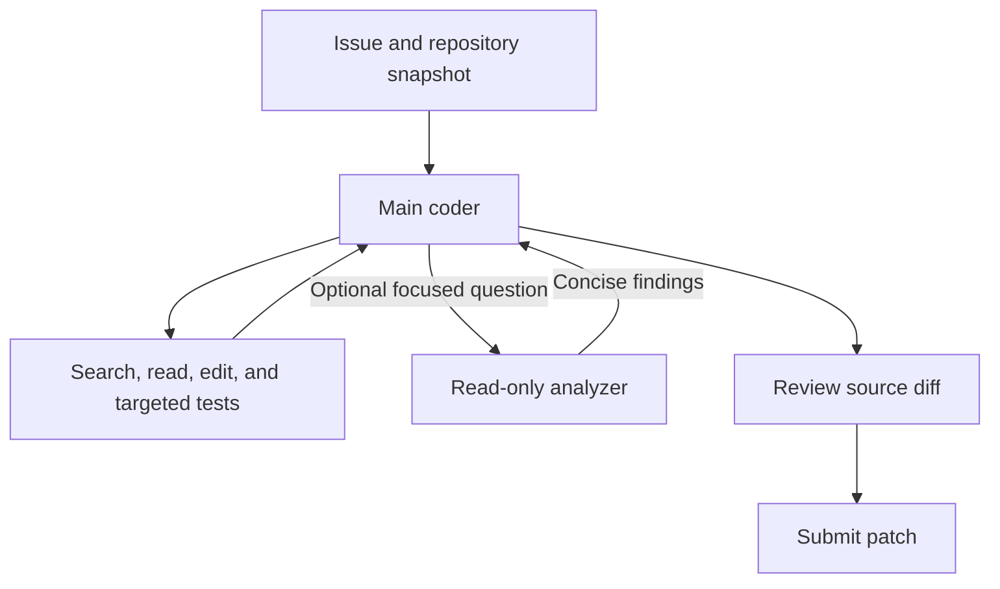

# Agent system selection

Decision date: 2026-10-06.

## Selected architecture

Use a Kaggle-native main coding `LlmAgent` with one optional read-only analyzer exposed through `agent_tool`. Both use the unchanged `gemma-4-31b-it-qat-w4a16-ct` competition model. Omit all `adapter:` declarations and adapter files in the initial candidate.

This is an architecture decision for our first candidate, not a measured claim that it outperforms other systems. It is now implemented in `submission_1/`, with a comparison notebook and local validation, packaging, and diagnostic tools described in [the workflow guide](README.md). No new inference or benchmark has been run. The downloaded baseline and original starter notebook remain unchanged; the previous candidate's sample adapters are preserved outside the active submission under `reference_adapters/submission_1/`.

The main coder owns planning, source edits, targeted verification, final diff inspection, and `submit_patch()`. It can ask the analyzer a focused localization question when direct inspection leaves important uncertainty. The analyzer returns relevant files, symbols, evidence, and a proposed minimal change; it does not modify the workspace or submit patches.



## Design references

| Reference | Design idea to adopt |
|---|---|
| [mini-SWE-agent](https://github.com/SWE-agent/mini-swe-agent/blob/main/src/minisweagent/agents/default.py) | A short action/observation loop with clear completion and recorded trajectories. |
| [SWE-agent](https://github.com/SWE-agent/SWE-agent/blob/main/config/default.yaml) | Reproduce the issue, make a focused fix, verify, and inspect the final changes. |
| [OpenCode](https://opencode.ai/docs/agents/) | Specialize helpers through instructions and tool access. |
| [OpenHands SDK](https://github.com/OpenHands/software-agent-sdk) | Separate agent behavior, tool results, workspace, and conversation history. |
| [Aider](https://aider.chat/docs/repomap.html) | Select relevant files and symbols within a context budget. |

We express these ideas through the competition's supported YAML, prompts, and tools. The harness supplies the agent execution loop and sandbox. The open-source frameworks' Python or TypeScript runtimes are not our submission entrypoint.

## Evidence available now

The starter notebook's saved outputs show:

| Task | Resolved | Counted tool calls | Patch length | Reported task duration | Stop reason |
|---|---|---|---|---|---|
| `fastapi_15661` | No | 4 | 0 | 76.1 seconds | Agent timed out |
| `fastapi_15588` | No | 4 | 0 | 73.1 seconds | Agent timed out |

The sample allows one minute of agent time and ten tool calls. These two runs expired before producing code changes, with tool calls remaining. Reported task duration includes more than the agent-loop timer, so it should not be equated with that one-minute allowance. These failures do not demonstrate an incorrect patch, a context overflow, or a need for more agents.

The notebook loads the sample adapters; these results are not a base-model-only benchmark. Two tasks also cannot rank agent architectures or establish a representative success rate.

Local evaluation is not ready: `swegemma` and `adk_submission` are absent from the inspected Python environment. The downloaded data has 129 task records, two snapshots, three graph files, and two embedding files. The snapshots are `fastapi_14360` and `fastapi_13713`; neither has its matching graph or embedding archive. No task currently has all three matching artifacts. Match files using each task's `instance_id`, repository short name, and `base_commit` before running the notebook as written.

## Component choices

| Component | Initial choice | Purpose |
|---|---|---|
| Main agent | One coder with all nine core harness tools | Keep edits, tests, and submission under one owner. |
| Analyzer | Optional `agent_tool`; `read_file` plus the three graph/retrieval tools | Isolate exploratory file reads and return compact findings. |
| Planning and review | Performed by the coder | Make these steps available without a mandatory additional model call. |
| Adapters | None initially | Establish unchanged-model performance before training. |
| Context | Harness history and compaction; bounded file reads and concise helper reports | Keep request context focused. No custom session database is introduced. |
| Retrieval | Direct paths/text search when the issue supplies concrete names; graph/semantic retrieval when useful | Limit repeated or irrelevant searches. |
| Testing | Targeted existing tests or small reproductions | Verify the change within time and output budgets. |
| Submission | Inspect diff, clean scratch artifacts, call `submit_patch()` last | Capture a source patch before the task stops. |

An initial prompt convention can limit analyzer delegation to one focused request. This is a behavioral instruction, not a separately enforced helper quota. Agent and helper work consume the task's available resources.

## Initial settings to validate

Initial implemented `eval_config.yaml`:

```yaml
evaluation:
  max_time_minutes: 4
  max_tool_calls: 40
  max_turns: 80
  timeout_seconds: 60
```

Keep the starter's known sampling configuration for the first comparison:

```yaml
temperature: 0.2
top_p: 0.95
max_output_tokens: 16384
thinking_config:
  thinking_budget: 4096
  include_thoughts: true
```

These are starting experimental values, not proven optimum settings. Omit `thinking_level`, as the starter does. Test a lower thinking budget separately after the first baseline is available. Generated output and input together must fit the 32,768-token context window.

At approximately 120 hidden tasks, four minutes per task corresponds to eight hours of agent time under sequential execution. The remaining four hours within the global twelve-hour envelope is only a planning allowance for setup and other overhead. Measure the full inference run and use the actual task count; per-task timings alone do not prove compliance. Verification time is excluded from the global limit.

## Submission boundaries

The [official competition overview](https://www.kaggle.com/competitions/gemma-4-developer-agent/overview) requires the same permitted Gemma model for all agents, makes LoRA adapters optional, restricts tools to the harness and configured subagents, and permits sandboxed skill scripts. It sets twelve hours for all patch generation, including setup and excluding verification.

The downloaded `HARNESS_README.md` documents the native agent types, 32,768-token context, approximately 3 GiB maximum unpacked submission, allowed extensions, and a scoring Docker sandbox with 4 GiB RAM and two CPUs. The initial text/YAML candidate should remain comfortably below the archive size limit.

Implemented package layout:

```text
submission.zip
├── agent.yaml
├── eval_config.yaml
├── configs/sampling.yaml
├── prompts/system.md
└── sub_agents/
    ├── code_analyzer.yaml
    └── analyzer_resources/
        ├── instruction.md
        └── sampling.yaml
```

The analyzer's resources are colocated so all includes are downward relative paths. The sample uses `../` includes while the guide describes stricter path validation; this candidate avoids that ambiguity. The actual installed compiler still needs to be checked in the competition environment.

Notebook settings do not all become submission settings. Its subprocess sandbox, GPU utilization of 0.90, and compaction interval of 15 differ from the documented scoring Docker backend, 0.80 utilization, and interval of 5. Session storage, caching, compaction policy, and built-in tool implementations belong to the harness.

The guide says verification resets changes to protected tests and runner configuration. Keep fixes in the intended implementation files and put temporary reproductions under `/tmp`; do not depend on modified tests or configuration to earn a pass.

## Performance breakdown and promotion criteria

| Failure stage | Evidence to examine | First intervention |
|---|---|---|
| Runtime/setup | Model, container, dependency, or configuration error | Restore a valid evaluation environment. |
| Code localization | Repeated searches, irrelevant retrieval, no relevant file read | Improve search prompts or use a focused analyzer request. |
| Editing/completion | No source change before the timer expires | Reduce exploration and reasoning overhead; reconsider budgets. |
| Tool execution | Invalid/truncated call, ambiguous replacement, command timeout | Use smaller edits and bounded commands; improve tool instructions. |
| Context | Per-request token usage, compaction events, context-length error | Reduce raw file/output volume and preserve concise findings. |
| Patch capture | Empty patch or unwanted scratch files | Check the diff and submit explicitly. |
| Patch verification | Patch-application error or failing required tests | Correct the implementation and targeted verification strategy. |
| Total runtime | Full inference elapsed time, setup time, task coverage | Tune task budgets and reduce recurring overhead. |

Record resolution rate, nonempty-patch rate, stop reason, time to first edit, agent elapsed time, counted tool calls, model requests, per-request token usage when available, and delegation overhead. `get_status()` and `submit_patch()` are exempt from the counted tool-call budget. The documented status output gives `max_turns` but not `turns_used`; model-request counts are useful diagnostics, and exact enforcement semantics should be confirmed from the installed runtime and stop logs.

1. Install the competition runtime versions and validate the candidate with its compiler, model validator, archive size checks, and extension checks.
2. Obtain matching data for a smoke task and evaluate it without adapters. Do not expose reference patches or verification patches as agent input.
3. Compare coder-only and optional-analyzer variants on the same fixed public tasks, model, prompts, budgets, and generation settings. Use multiple repositories before drawing broad conclusions.
4. Use an initial development set of 24 tasks, six each from FastAPI, Requests, Rich, and HTTPX; keep other tasks separate for validation. This is a proposed selection, not an executed benchmark.
5. Prefer the variant that solves more tasks within the time envelope. Use runtime and call efficiency as secondary criteria. Retain the analyzer only when it provides a measurable benefit.
6. Check Docker parity, full task coverage, and total inference time before calling the system submission-ready.
7. Use failure evidence and successful trajectories to decide what to fine-tune later.

The selected first candidate is the main coder with optional analyzer. Promotion to a final submission depends on measured validation; this document records the choice and the checks still required.
