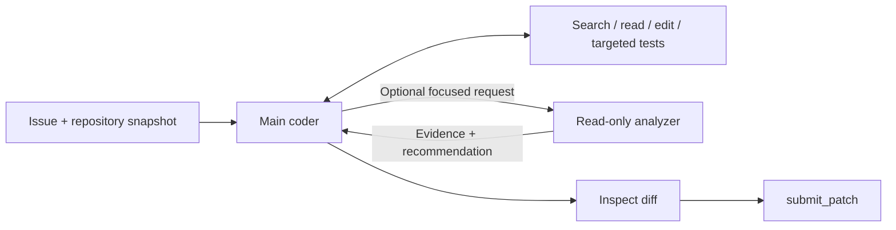

# Submission 1

This candidate uses the unchanged competition Gemma model. The main coder owns source changes, tests, diff review, and patch submission. A read-only analyzer is available for a focused question when direct inspection leaves uncertainty. It is optional during each task.

## Files and responsibilities

| File | Change here when improving |
|---|---|
| `agent.yaml` | Main agent tool access and helper connections. |
| `prompts/system.md` | Navigation, delegation, editing, verification, and completion behavior. |
| `configs/sampling.yaml` | Main generation and thinking settings. |
| `sub_agents/code_analyzer.yaml` | Analyzer tools, isolated history, output state, and resource references. |
| `sub_agents/analyzer_resources/instruction.md` | Analyzer evidence and report requirements. |
| `sub_agents/analyzer_resources/sampling.yaml` | Analyzer output and thinking settings. |
| `eval_config.yaml` | Enforced task time, counted tool calls, turns, and command timeout. |

Initial task budgets are **4 minutes, 40 counted tool calls, 80 turns, and 60 seconds per command**. The analyzer's four-call and 300-word targets are prompt instructions, not independently enforced limits. Both agents share the task resources. The main model retains the starter's 16,384 output-token ceiling and 4,096 thinking budget; the analyzer uses 2,048 and 1,024. Each model request must fit the harness's combined context window.

No `adapter:` is declared. The previous sample weights are preserved at `../reference_adapters/submission_1/`, outside this candidate. They are not included in its package.

## Extension points

1. Improve prompts before changing topology. Evaluate one change at a time on the same fixed task IDs and retain the previous run's artifacts.
2. Add a helper in `sub_agents/` with its own resources, then connect it through `agent_tool` in `agent.yaml`. Use the permitted Gemma alias, a specific description, and the smallest useful tool set. Prefer optional delegation until measurements justify mandatory steps. Colocate resources to avoid upward include paths.
3. Add a supported skill directory with `SKILL.md` and any permitted resources/scripts, and reference it through the agent's `skills` field. Check the harness guide for the skill schema and tool access; skill scripts run inside its sandbox.
4. Add a trained PEFT adapter under `adapters/<name>/` with `adapter_config.json` and `adapter_model.safetensors`, and set `adapter: <name>` on the intended agent. Revalidate the archive and compare against the unchanged-model baseline. The local builder rejects unreferenced adapter assets.
5. Adjust budgets and sampling separately from prompt or adapter experiments. Measure end-to-end inference time, including setup, before increasing per-task allowances.

The competition harness supplies execution, built-in tools, session history, compaction, and verification. These files configure those capabilities; they do not replace the harness with an external agent runtime.

## Evaluation and observability

Use the companion [evaluation notebook](../evaluate_submission_1.ipynb) and [workflow guide](../README.md). They compare this candidate with a control that removes the analyzer connection while keeping the coder, model, sampling, and budgets unchanged. The notebook's two-task default is a smoke test. Broader measurements across repositories are needed to choose a final variant.

Diagnostics live outside the submitted archive. They retain task results, exact patches, test output, logs, and any traces produced by the installed runtime. A report links failures to available evidence and flags missing instrumentation. It cannot infer context consumption, successful edits, or helper cost when the runtime did not record them.

This configuration has been prepared for evaluation. GPU inference, the authoritative competition compiler, Docker parity, and performance promotion still require the competition environment.
