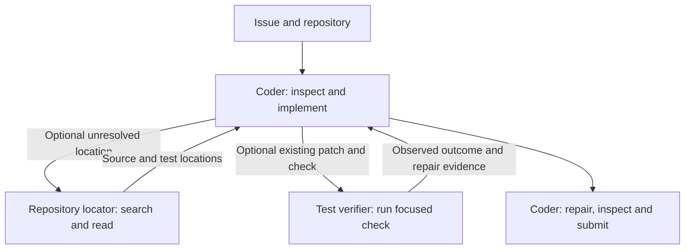

# Submission 4: coder, repository locator and test verifier

Prepared on 2026-10-12 after the user reported Submission 3 at **0.0**, with no Kaggle error message. Submission 2 scored 0.10 and Submission 1 scored 0.06 and 0.10. No task-level logs were supplied, so Submission 3's failure cause is unknown. Its ZIP passed local archive-integrity checks and its normalized text matched the preserved source; this does not prove that it executed correctly or produced useful patches.

Submission 4 uses three configured Gemma agents with different helper responsibilities:

| Agent | Tools | Responsibility |
| --- | --- | --- |
| `swe_coder_agent` | `run_command`, `read_file`, `edit_file`, `write_file`, `get_status`, `submit_patch`; both helper tools | Own implementation, repairs, final inspection and submission. |
| `repository_locator_agent` | `run_command`, `read_file` | Find affected implementation and a relevant existing test using bounded shell search. |
| `test_verifier_agent` | `run_command`, `read_file` | Execute one focused check and distinguish behavior failures from collection/dependency errors, timeouts and tool errors. |



## What changes

- Shell-based localization replaces the graph-based analyzer. Graph tools are omitted from every agent's declared tool list.
- A verifier that can execute tests replaces the previous read-only patch reviewer. The coder supplies the issue, changed paths, relevant patch/source evidence and prior test results.
- Coder instructions are shorter and center on producing a complete implementation, resolving demonstrated failures and capturing the patch.
- The main agent has six direct tools. Helpers have no editing, submission or delegation tools. Their shell access can technically write files, so preservation of implementation, protected tests and the environment is a prompt restriction, not a read-only sandbox guarantee.
- Both helpers use `include_contents: none` and `skip_summarization: true`. Requests must be self-contained. Neither helper uses session-state output placeholders.

The retained root-with-helper-tools topology keeps the coder in control of task completion. A mandatory sequential pipeline is not introduced because the local harness documents final-response termination. The usefulness of this design remains an experimental question.

## Budget and routing

All agents use the unchanged `gemma-4-31b-it-qat-w4a16-ct` competition model; no adapters. The coder's sampling and `eval_config.yaml` are byte-identical to Submission 2:

- Four minutes, 40 counted calls, 80 turns and a 60-second command cap for the task.
- Coder: temperature 0.2, top-p 0.95, output ceiling 16,384 and declared thinking budget 4,096.
- Both helpers: temperature 0.2, top-p 0.95, output ceiling 2,048 and declared thinking budget 1,024, matching Submission 2's helper sampling.

Actual backend handling of thinking settings still needs runtime verification. Helpers share the task allowance and have no independent hard quota.

The coder delegates localization only for an unresolved implementation/test location and skips it below 150 seconds or eight remaining counted calls. It delegates verification only after a patch exists when test selection or failure interpretation needs help, skipping below 90 seconds or six calls. Each helper is called at most once by prompt convention. Obvious checks stay with the coder; a successful check already supplied is not repeated without a reason. Failed/unhelpful delegation falls back to direct coder tools. The last 30 seconds are reserved for repair, final inspection and submission.

The locator targets one or two focused inspection calls and a 120-word report. The verifier normally runs one short command, optionally reads one source range, and returns at most 150 words with the actual command, outcome, repair evidence and coverage gaps. A failed collection, missing dependency, timeout or no collected tests is inconclusive. Tests/reproductions do not establish hidden-verification success. These counts, thresholds and response lengths are behavioral instructions, not enforced helper limits.

## Package and evaluate

From the project root:

```bat
python -B submission_nb\tools\submission_tools.py validate --submission-dir submission_nb\submission_4
python -B submission_nb\tools\submission_tools.py build --submission-dir submission_nb\submission_4 --output submission_nb\artifacts\submission_4.zip
python -B submission_nb\prepare_evaluation_notebook.py --submission-dir submission_nb\submission_4 --verification-control --output submission_nb\evaluate_submission_4.ipynb
```

`evaluate_submission_4.ipynb` embeds the actual candidate and current diagnostic tools. It compares four variants on identical tasks, with the same coder prompt, shared sampling and task budget:

| Variant | Configured agents | Helper availability |
| --- | ---: | --- |
| `coder_only` | 1 | Neither helper. |
| `optional_locator` | 2 | Locator only. |
| `optional_verifier` | 2 | Verifier only. |
| `locator_verifier` | 3 | Both; default release. |

Unused helper connections and unreachable resources are removed from each control package. These controls isolate helper availability within Submission 4. Compare historical Submission 2 and Submission 3 using their actual configurations and the same task IDs; their different prompts/tools make them separate release comparisons.

Start with the default two-task smoke check in Kaggle with competition data, model and wheelhouse attached. Then pin a development task set spanning repositories and task types, keep separate validation tasks, and repeat/reverse promising comparisons. Inspect resolved outcomes, empty patches, stop causes, first edit, observed token usage and tool frequencies. Reports expose `locator_calls`, `verifier_calls` and `helper_calls_by_name` when trace evidence exists; missing usage stays unknown. Per-agent token attribution and complete per-stage timing are not yet implemented. Preserve raw traces, patches, verification output and manifests for those analyses.

The notebook packages its evaluated release variant to `/kaggle/working/submission.zip`. Documentation, notebooks, reports and local tests are excluded from the agent ZIP. The local archive contains ten active files and has `agent.yaml` at its root.

## Validation limits

Local tests check dependency closure, shared controls, sampling/budget preservation, helper permissions, prompt placeholders, diagnostic counts and archive/notebook consistency. They do not measure coding-task resolution or execute real Gemma inference. The current local environment lacks the competition runtime and model/GPU setup; official compilation, inference, verification, scoring Docker parity and total runtime still require Kaggle or an equivalent environment.

Submission 4 has no measured public score. This candidate changes helper roles, direct tool availability and prompts together; an improvement would not identify which change caused it. The four controls support a narrower helper-availability comparison within this release.
