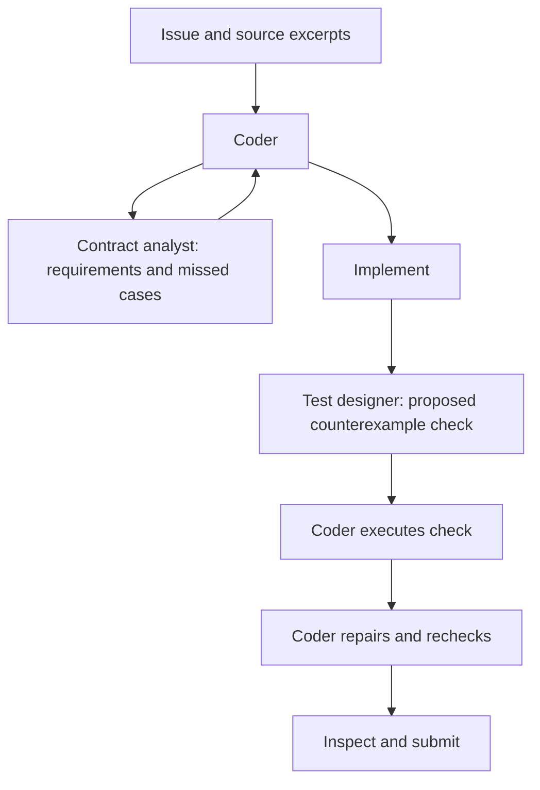

# Submission 7: contract analyst, coder and counterexample test designer

Revised on 2026-10-18 using the new Submission 4 and 6 diagnostics. **Three configured agents, all using gemma-4-31b-it-qat-w4a16-ct. No measured Submission 7 score.**

The coder owns repository tools, edits, test execution and submission. Both helpers now have no declared tools and return compact advice from supplied evidence. This replaces the original Submission 7 helpers' shell/read access after a diagnostic locator call consumed 26 tools and 163 seconds. The coder's output ceiling also changes from 16,384 to 8,192 to reduce context reservation failures.

| Agent | Responsibility | Declared tools |
| --- | --- | --- |
| Coder | Inspect, implement all requirements, execute checks, repair and capture the patch. | Six harness tools and both helper connections. |
| Contract analyst | Review the issue and supplied excerpts for missing requirements, compatibility constraints and affected API layers. | None. |
| Counterexample tester | Independently derive an expectation and propose a short executable check. Clearly label it NOT RUN. | None. |

The existing counterexample_tester_agent name is retained, but the coder now executes its proposed check and interprets the actual output. A helper response is never treated as verification.



Helpers remain selective. A fully understood small task can stay with the coder. The analyst is considered after initial inspection; the test designer is considered after the first substantive patch when important coverage is missing. Neither helper can conduct its own repository investigation. This limits tool overhead but makes the quality of supplied excerpts important; missing information must be reported rather than invented. All roles share a model, so independent instructions do not eliminate correlated errors.

## Evidence and corresponding changes

The [diagnostic review](../../tests_on_tasks/diagnostics/submission_4_6_review/review.md) and its reproducible evidence contain the detailed findings:

| Observation | Revision |
| --- | --- |
| Submission 4: two context rejections with a 16,384 output reservation; maximum observed response 3,976 tokens. | Coder output ceiling 8,192; thinking stays enabled. Bounded reads and explicit handling of truncated ranges. |
| Submission 4: 32 rejected scratch writes outside the workspace; reproduction files then appear in returned patches. | Use shell/stdin for checks and shell creation for necessary /tmp files. Never use write_file for /tmp. |
| Submission 4: 21 argument-validation errors, including repeated identical rejected writes/edits. Submission 6: 40 unmatched edits. | Separate native tool fields, shorter corrected calls, no identical failed retries, and an assertion-guarded shell fallback after two failures. |
| Submission 4: one expensive locator invocation and no verifier calls. | Both helpers declare tools: []; coder retains all execution and calls each at most once by prompt policy. |
| Partial API changes and broken runtime imports. | Follow behavior through wrappers/constructors/consumers and verify runtime uses of moved imports. |
| Repeated submission and post-capture work. | After successful capture, return a completion response without further tool calls. |

These are general instructions, with no task-specific expected answers or grading-patch contents in the prompts.

The runs report 4/30 resolved for Submission 4 and 1/30 for Submission 6. One Submission 4 pass has an empty patch. Their model and agent designs differ, both disable the session timer, and several grading results include missing test dependencies or recursive fixtures. These outcomes neither isolate architecture quality nor predict the revised candidate's public score. The current [public records](../../submission_records.md) remain authoritative for the separately reported leaderboard scores.

## Settings and limits

| Setting | Revised value |
| --- | --- |
| Model, all three agents | gemma-4-31b-it-qat-w4a16-ct; no adapters |
| Task allowance | Four minutes, 40 counted calls, 80 turns |
| Command timeout | 60 seconds |
| Coder sampling | Temperature 0.2, top-p 0.95, output ceiling 8,192; thinking_budget 4,096 and include_thoughts true |
| Both helpers | Temperature 0.2, top-p 0.95, output ceiling 2,048; thinking_budget 1,024 and include_thoughts true |

The evaluation config and helper sampling files remain byte-identical to Submission 4. Only max_output_tokens changes in the coder sampling configuration. At a 32,768-token context limit, an 8,192 output reservation leaves nominal input headroom of 24,576 tokens. It does not prevent every overflow or guarantee sufficient output for future tasks. Actual thinking-budget behavior remains backend-dependent.

Both helpers keep include_contents: none and skip_summarization: true. Requests must carry the issue and decisive excerpts explicitly. No callbacks, session-state placeholders or custom runtime are introduced. Empty tool declarations remove their configured shell/read capabilities; at-most-once invocation, response length and time thresholds remain prompt policies.

The analyst is skipped below 165 seconds or 12 remaining counted calls; the test designer below 90 seconds or eight calls. The coder reserves roughly eight calls and the final 30 seconds for repair, verification and capture. It treats an absent/disabled timer as unknown/unbounded rather than zero, and still respects the call budget.

## Build and compare

From the project root:

```bat
python -B tests_on_tasks\tools\submission_tools.py validate --submission-dir submission_nb\submission_7
python -B tests_on_tasks\tools\submission_tools.py build --submission-dir submission_nb\submission_7 --output submission_nb\artifacts\submission_7.zip
```

The ZIP contains ten active files with agent.yaml at its root. This README and the [hash manifest](../artifacts/submission_7.manifest.json) remain outside the package.

Use the [existing testing notebook](../../tests_on_tasks/gemma-4-developer-agent-testing_v5.ipynb), point Submission_DIR to the mounted candidate directory containing agent.yaml, and select 31B weights. For release-budget comparisons set EVAL_OVERRIDES['max_time_minutes'] = INHERIT; the diagnostic runs used None. Keep all other evaluator, verification, observer and compaction settings identical and inspect the saved effective settings.

Compare unchanged Submission 4, Submission 4 with only the 8,192 coder ceiling, and this revised candidate. This separates the output-reservation intervention from the remaining prompt/helper changes. The [original Submission 7 ZIP](../../tests_on_tasks/diagnostics/submission_4_6_review/pre_revision_submission_7.zip) and manifest are preserved for a direct before/after comparison. Controls are proposed experiments, not newly evaluated variants.

The [next evaluation sets](../../tests_on_tasks/diagnostics/submission_4_6_review/next_evaluation_sets.json) retain the frozen smoke/pilot/extended development sets and identify 35 remaining validation tasks. Four tasks originally labelled validation were exposed in the new diagnostics and are excluded, along with any exposed snapshot groups. Original task inventory files are unchanged.

Inspect actual helper use, executed checks, paired task outcomes, context errors, rejected calls, scratch files and elapsed time. First confirm a helper returns, the coder runs its check and a nonempty patch reaches grading. Treat missing dependencies/recursive fixtures as inconclusive verification, with separate evidence for any implementation defect. Do not use agent edits to test infrastructure to repair the evaluator. Confirm scoring-runtime parity and total generation time before promotion.

## Validation status

Local checks cover three 31B declarations, tool-free helpers, unchanged task/helper settings, the isolated coder sampling change, dependency closure, ZIP integrity and byte-for-byte agreement with source. The packaging/diagnostic tests also run locally; their stale Submission 4 fixture path was corrected after the tools moved to tests_on_tasks. Results and archive hashes are recorded in the manifest.

This workspace lacks the competition runtime/model setup for real Gemma evaluation. No new Kaggle run, upload or improved-score claim accompanies this revision.
