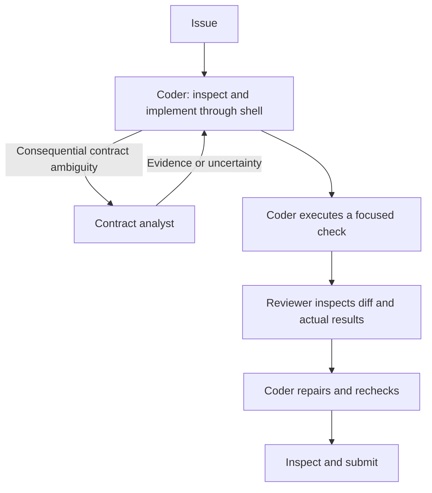

# Submission 8: shell-based coder with contract analysis and patch review

Prepared on 2026-10-18 from the evaluated Submission 7. **Three configured agents, all using `gemma-4-31b-it-qat-w4a16-ct`. Unmeasured candidate.**

Submission 7 tied Submission 4 at 4/30 resolved in the new diagnostic run, gaining one task and losing another. It eliminated observed context exceptions and rejected `/tmp` file writes, but still generated 33 malformed edit/write calls and exhausted 40 calls on twelve tasks. Its test-design helper was never invoked. See the [performance review](../../tests_on_tasks/diagnostics/submission_7_review/review.md) and [paired task results](../../tests_on_tasks/diagnostics/submission_7_review/paired_tasks.csv).

## Architecture

| Role | Responsibility | Tools |
| --- | --- | --- |
| Coder | Search, read, implement, execute checks, repair and capture the patch. | `run_command`, `get_status`, `submit_patch`, and both helper connections. |
| Contract analyst | Check the issue interpretation against supplied original text and source evidence; separate supported requirements from assumptions. | None. |
| Patch reviewer | Inspect the actual implementation diff and reported verification outcomes for supported blockers and missing behavior. | None. |



The coder no longer declares `read_file`, `edit_file` or `write_file`. A single command string handles repository operations, removing the malformed multi-field edit/write interface observed in Submission 7. Shell commands can still have syntax, quoting or semantic errors. The prompt supplies a Python heredoc pattern that asserts a unique source match and compiles Python before writing; it does not add a custom runtime or tool.

The analyst must quote the original issue to label a requirement explicit. Available filenames and the coder's suggestions are insufficient. Sparse or inaccessible requirements remain uncertain. The reviewer replaces the unused counterexample test designer and receives the actual patch plus observed outcomes, rather than only designing a future check. It can propose one additional check but cannot claim execution.

All agents remain `LlmAgent`s using `agent_tool` connections, with `include_contents: none` on helpers and `skip_summarization: true`. Helpers cannot inspect files: the coder must supply self-contained evidence and identify omitted diff portions. Their empty tool lists prevent repository-tool loops through those declarations, but invocation count and latency are not hard-capped independently of the task budget.

## Work order and settings

The root prompt uses five stages: status, locate, implement, check/review, submit. It discourages spending the entire task constructing a reproduction before implementing a supported fix. It requires confirmed API/test paths, working-tree imports and final inspection for scratch-only patches. A failed or incomplete check remains accurately reported.

The analyst is used once for consequential ambiguity when at least twelve calls remain, unless a known timer is below 120 seconds. After an implementation exists, review is the normal checkpoint when at least six calls remain, unless a known timer is below 60 seconds. With no reported timer, the call thresholds apply. A missing helper or short budget falls back to coder inspection. These are prompt policies; smoke testing must establish actual helper use.

All four budget/sampling files are copied byte-for-byte from Submission 7:

| Setting | Value |
| --- | --- |
| Task allowance | Four minutes, 40 counted calls, 80 turns |
| Command timeout | 60 seconds |
| Coder | Temperature 0.2, top-p 0.95, output ceiling 8,192, declared thinking budget 4,096; thinking enabled |
| Both helpers | Temperature 0.2, top-p 0.95, output ceiling 2,048, declared thinking budget 1,024; thinking enabled |
| Adapters | None |

Actual backend enforcement of thinking budgets remains runtime-dependent. The 8,192 ceiling avoids returning to the earlier large output reservation, but does not prevent every context overflow or long generation. Submission 7 had one response that reached that ceiling and took about 236 seconds. Small source changes and brief reasoning are requested; per-response latency still requires measurement.

## Build and test

Run from the project root:

```bat
python -B tests_on_tasks\tools\submission_tools.py validate --submission-dir submission_nb\submission_8
python -B tests_on_tasks\tools\submission_tools.py build --submission-dir submission_nb\submission_8 --output submission_nb\artifacts\submission_8.zip
```

The ZIP contains ten active files and has `agent.yaml` at its root. This README, local reviews and the sibling hash manifest stay outside it. Submission 7 is preserved.

Use the existing [testing notebook](../../tests_on_tasks/gemma-4-developer-agent-testing_v5.ipynb) with the candidate mounted and 31B weights selected. Set `Submission_DIR` to the actual directory containing `agent.yaml`. Set `EVAL_OVERRIDES['max_time_minutes'] = INHERIT` when comparing release budgets; the supplied Submission 7 run disables the task timer. Keep command/final-verification timeouts, compaction and instrumentation matched between variants and inspect the saved effective settings.

Begin with the fixed smoke tasks, confirming shell-based source edits, at least one reviewer return, coder continuation and intended patch capture. Then compare paired outcomes with Submission 7 and use the [remaining validation tasks](../../tests_on_tasks/diagnostics/submission_4_6_review/next_evaluation_sets.json) if promising. A reviewer-disabled control can isolate helper availability within this prompt; no control results are claimed here.

Missing `inline_snapshot` and recursive `httpbin` fixtures still obstruct several diagnostic grading runs. Those require a separate evaluator-environment investigation; they are not repaired by modifying protected tests in the agent. Distinguish environment-inconclusive results from executed behavioral failures. Validate scoring-runtime parity and full inference duration before promotion.

## Validation limits

Local checks passed for the three 31B declarations, allowed tools and includes, unchanged sampling/budgets, helper isolation, package integrity and source/archive byte equality. The Python edit-pattern body passed four fixture checks, including rejection without writing for missing/ambiguous matches and invalid Python. The existing packaging/diagnostic suite passed 22 tests with one platform-dependent skip. The official competition compiler and real Gemma execution are unavailable in this workspace. Check results and file hashes are recorded in [the manifest](../artifacts/submission_8.manifest.json); [prepare_submission_8.py](../../tests_on_tasks/diagnostics/submission_7_review/prepare_submission_8.py) reproduces the candidate checks and build.

This is an evidence-based candidate. No new model evaluation, upload or score improvement is claimed.
