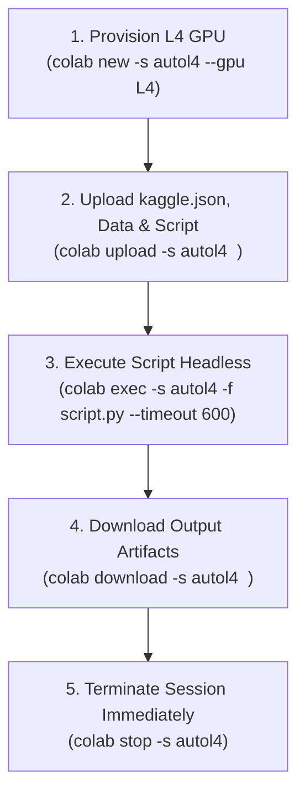

# Colab GPU Setup & Execution Roadmap for Kaggle WSP

A concise, step-by-step roadmap for **Gemini / Codex / Antigravity** to execute Kaggle WSP experiments on Google Colab GPUs with zero guesswork and complete Kaggle environment compatibility.

---

## 🗺️ Execution Roadmap (Quick Reference)



---

## 1. Prerequisites Needed From User

> [!TIP]
> **Key Insight**: To load and reproduce the entire Kaggle competition environment in Colab, **the ONLY thing required is the Kaggle API key** (`kaggle.json`). You do **not** need to manually download or upload large model weights or datasets—Colab pulls everything directly from Kaggle servers in seconds.

Depending on how you run Colab:

| Running Mode | What You Need to Provide | What It Does |
| :--- | :--- | :--- |
| **A. Loading Kaggle Env in Colab** *(Any mode)* | **Kaggle API Key Only** (`kaggle.json`) | Automatically pulls the competition wheelhouse, Gemma 4 model weights, and recreates `/kaggle/input/...` via `kagglehub`. |
| **B. Headless Agent CLI Automation** *(Gemini / Codex)* | **Colab Pro Account + Google Login** | Gives the agent permission to spin up, run, and stop **NVIDIA L4 (24 GB)** instances programmatically from the terminal. |

---

## 2. Agent Local & Remote Configuration

### A. Local Setup (CLI)
- **Colab CLI Command**: `colab` (Installed via `uv tool install google-colab-cli`).
- **OAuth Scope Patch** *(Required once if fresh install)*:
  In `%APPDATA%\uv\tools\google-colab-cli\Lib\site-packages\colab_cli\auth.py`, restrict scopes to:
  `['openid', 'https://www.googleapis.com/auth/userinfo.profile', 'https://www.googleapis.com/auth/userinfo.email', 'https://www.googleapis.com/auth/colaboratory']`
  and set `os.environ["OAUTHLIB_RELAX_TOKEN_SCOPE"] = "1"` (fixes `invalid_scope: Bad Request`).

### B. Remote Environment Variables
Include at the head of every remote Python script:
```python
import os
os.environ["KAGGLE_CONFIG_DIR"] = "/content"
os.environ["TRANSFORMERS_NO_TF"] = "1"
os.environ["TRANSFORMERS_NO_FLAX"] = "1"
os.environ["PYTORCH_CUDA_ALLOC_CONF"] = "expandable_segments:True"
```

---

## 3. Kaggle Environment Bridge (Zero Code Changes)

Kaggle notebooks and scripts hardcode `/kaggle/input/...` and `/kaggle/working`.
Paste this drop-in block at the top of your remote script/notebook. It automatically authenticates via the uploaded `kaggle.json`, downloads the competition wheelhouse and model weights via `kagglehub`, and symlinks them into identical Kaggle paths:

```python
import os, shutil
from pathlib import Path
import kagglehub

# 1. Download assets directly to Colab cache via kagglehub
# (kagglehub automatically authenticates using /root/.kaggle/kaggle.json or /content/kaggle.json)
whl_dir = Path(kagglehub.dataset_download("metric/gemma-4-developer-agent-wheelhouse"))
model_dir = Path(kagglehub.model_download("google/gemma-4/Other/gemma-4-e4b-it-qat-w4a16-ct/2"))

# 2. Mirror exact Kaggle directory tree
kaggle_input = Path("/kaggle/input")
kaggle_input.mkdir(parents=True, exist_ok=True)
Path("/kaggle/working").mkdir(parents=True, exist_ok=True)

# Symlink wheelhouse & model
(kaggle_input / "datasets/metric").mkdir(parents=True, exist_ok=True)
(kaggle_input / "datasets/metric/gemma-4-developer-agent-wheelhouse").symlink_to(whl_dir)

(kaggle_input / "models/google/gemma-4/other").mkdir(parents=True, exist_ok=True)
(kaggle_input / "models/google/gemma-4/other/gemma-4-e4b-it-qat-w4a16-ct/2").symlink_to(model_dir)

# 3. Install competition packages
for pth in Path("/usr/local/lib").glob("python*/dist-packages/*cutlass*.pth"):
    try: pth.unlink()
    except OSError: pass

wheels = sorted(str(w) for w in whl_dir.glob("*.whl") if not "cutlass" in w.name.lower() and any(w.name.startswith(p) for p in ("transformers-", "tokenizers-", "safetensors-", "compressed_tensors-", "loguru-")))
import subprocess, sys
subprocess.run([sys.executable, "-m", "pip", "install", "-q", "--no-deps", "--force-reinstall", *wheels], check=True)
```

---

## 4. Hardware Selection Rule: Always Use L4 (24 GB)

> [!CRITICAL]
> **Never use `--gpu T4` for Gemma 4 full-model runs.**
> - Gemma 4 INT4 weights on disk are ~2.5 GB.
> - On the first forward pass, `compressed_tensors` decompresses all 1,758 linear layers into FP16/BF16 weights (**~16.2 GB total VRAM**).
> - **T4 (14.56 GB)**: Crashes at 60% with `CUDA Out of Memory`.
> - **L4 (23.85 GB)**: Decompresses 100% in 1 second, leaves **6.08 GB free VRAM**, runs 3.5× faster than Kaggle T4.
> - **Rule**: Always pass `--gpu L4`.

---

## 5. Agent Operational Commands (Copy-Paste)

### Step 1: Provision L4 Runtime
```powershell
colab new -s autol4 --gpu L4
```

### Step 2: Upload Kaggle Credentials & Files
```powershell
colab upload -s autol4 "~/.kaggle/kaggle.json" "/root/.kaggle/kaggle.json"
colab upload -s autol4 "local_path/script.py" "/content/script.py"
colab upload -s autol4 "local_path/data.json" "/content/data.json"
```

### Step 3: Run Headless Script
```powershell
colab exec -s autol4 -f "local_path/script.py" --timeout 600
```

### Step 4: Download Artifacts
```powershell
colab download -s autol4 "/content/output_basis.pt" "local_path/output_basis.pt"
colab download -s autol4 "/content/report.json" "local_path/report.json"
```

### Step 5: Terminate Runtime (Zero Idle Burn)
```powershell
colab stop -s autol4
```

---

## 6. Interactive Notebook Browser Access (Optional)

If human interaction or visual inspection in Jupyter is needed:
1. Provision session: `colab new -s my-session --gpu L4`
2. Get web URL: `colab url -s my-session`
3. Open the URL in browser and run the notebook.
4. Stop session when finished: `colab stop -s my-session`
