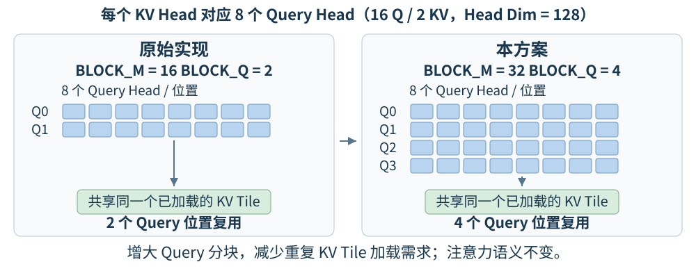
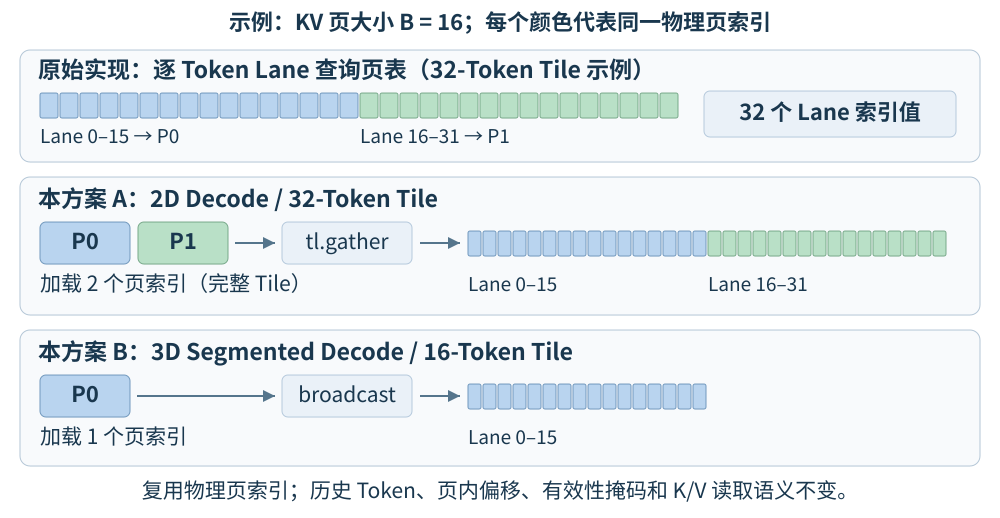

# 技术报告（v8）
## 团队名称: prince22466  

**优化对象：** MiniCPM5-2B  
**实验平台：** 天数 BI-V150  
**基础框架：** FlagOS / vLLM-FL

**测试结果与效果分析：** 官方 4K、16K benchmark 进行完整测试，与历史自测基线对比，指标为总吞吐量（Total tokens/s）。

| 测试场景 | 自测基线（tokens/s） | 本方案（tokens/s） | 绝对增益（tokens/s） | 相对增益 |
|---|---:|---:|---:|---:|
| 4K | 1,881.95 | 2,331.29 | +449.34 | **+23.88%** |
| 16K | 861.88 | 1,251.22 | +389.34 | **+45.17%** |

**精度测试：**  MATH-500 Level 3 准确率 > 95.0%。


### 方案设计思路

#### 1. 性能瓶颈（优化前）

- **Prefill 阶段：** 长序列注意力涉及大量 Q/K/V 分块计算。原有 GQA（Grouped-Query Attention，分组查询注意力）分块方式对同一 KV Tile 的复用不足，存在重复加载和分块执行开销。
- **Decode 阶段：** 每次生成一个 Token 时，需要访问历史 KV Cache。原有分页 KV 地址计算按 Token Lane 加载页表索引，同一物理页内存在重复的索引查询和地址计算。
- **长上下文服务：** 16K 高并发场景还受到 KV Cache 容量、请求排队、抢占及 Prefill/Decode 干扰的共同影响，因此不能仅依据单个算子的加速比判断最终服务吞吐量。

#### 2. 方案选择

基于上述分析，本方案采用**面向推理阶段和张量形状的算子特化策略**，在同一个 Triton Unified Attention 算子中集成两项优化：BF16 GQA Prefill 分块优化与 Pure Decode 分页 KV 索引复用。

### 算法原理及优化策略

#### 1. 基础算法：GQA 与分页 KV Cache

GQA 允许多个 Query Head 共享同一个 Key/Value Head。MiniCPM5-2B 在目标注意力配置下具有 16 个 Query Head、2 个 KV Head，Head Dimension 为 128，每个 KV Head 对应 8 个 Query Head。

对于一个 Query Head，标准缩放点积注意力计算可表示为：

$$
O = \operatorname{softmax}\left(\frac{QK^{\mathsf T}}{\sqrt{d}}+M\right)V
$$

其中 $d$ 为 Head Dimension，$M$ 为注意力掩码。不同 Query Head 可以复用相同 KV Head 的数据，但仍分别计算其注意力权重及输出。

vLLM 使用分页 KV Cache，通过逻辑页到物理页的映射定位历史 K/V 数据。对于逻辑 Token 位置 $t$ 和页大小 $B$，其物理页索引与页内偏移分别为：

$$
p(t)=\operatorname{BlockTable}\left[\left\lfloor t/B\right\rfloor\right],
\qquad r(t)=t\bmod B
$$

本方案不改变上述注意力公式、逻辑页映射、因果掩码及输出语义，而是优化 GPU 上的分块执行和物理页地址生成。

#### 2. Prefill：BF16 GQA 分块及 KV Tile 复用

原有 Triton Unified Attention 算子在目标 GQA 配置下使用 `BLOCK_M = 16`，每个 KV Head 对应 8 个 Query Head，因此一个 Query Block 包含的 Query 位置数为：

$$
\mathrm{BLOCK\_Q} = \frac{\mathrm{BLOCK\_M}}{8} = \frac{16}{8} = 2
$$

本方案在满足条件时将 `BLOCK_M` 增大至 32，使 `BLOCK_Q` 增大至 4。

| 分块参数 | 原始实现 | 本方案 |
|---|---:|---:|
| Query Head / KV Head 比例 | 8 | 8 |
| `BLOCK_M` | 16 | 32 |
| `BLOCK_Q` | 2 | 4 |

通过在同一个注意力计算块中处理更多 Query 位置，提高对已加载 KV Tile 的复用程度，减少重复加载同一 KV Tile 的需求，并减少长序列所需的 Query Block 数量。实际收益取决于序列长度、分块边界及 GPU 资源占用。



该优化通过 `optimize_prefill_gqa` 条件启用，适用范围包括：

- `max_seqlen_q > 1`，即批次中至少有一个请求的 Query 长度大于 1（包括符合条件的 Prefill 和混合批次）；
- Q/K/V 数据类型均为 BF16，16 个 Query Head、2 个 KV Head，Head Dimension 为 128；
- 非量化 KV Cache，因果注意力，且不使用 Tensor Descriptor；
- 不使用逐序列因果模式、Sliding Window、Chunk Lookback、多模态前缀、ALiBi、QQ Bias、Sink Tokens、Soft Cap 或输出量化等不兼容特性。

不符合条件的调用沿用原有分块选择逻辑。该优化仅调整算子内部的计算分块，不修改模型超参数，不裁剪注意力范围，也不引入稀疏近似。

#### 3. Decode：分页 KV 物理页索引复用

Decode 阶段需要反复读取历史 KV Cache。原有实现对一个 KV Tile 中的各 Token Lane 计算对应物理页索引，而同一页中的多个 Token 实际共享同一个物理页索引。

本方案在现有 Unified Attention Kernel 内引入编译期特化参数 `DECODE_PAGE_LOOKUP`，按照 KV Tile 与 KV 页的大小关系复用页表查询结果：

| 场景 | 标准 16-Token KV 页示例 | 优化方式 |
|---|---|---|
| 2D Decode | 32-Token Tile 覆盖 2 个页 | 加载 2 个物理页索引，通过 `tl.gather` 分配给相应 Token Lane |
| 3D Segmented Decode | 16-Token Tile 位于 1 个页 | 加载 1 个物理页索引，并广播至整个 Tile |
| 不符合特化条件 | 任意未支持配置 | 保留原有逐 Token 页表查询方式 |

通过合并同一物理页的索引加载，减少重复的页表加载及地址生成开销。各 Token 的页内偏移、有效性掩码及 K/V 读取语义保持不变；不减少参与注意力计算的历史 Token。



特化仅在以下条件全部成立时启用：

- `max_seqlen_q == 1`，即批次中最大 Query 长度为 1（Pure Decode 路径）；
- Q/K/V 数据类型均为 BF16，16 个 Query Head、2 个 KV Head，Head Dimension 为 128；
- KV 页大小为正整数且为 2 的幂，页大小与 Tile 大小中较大者为较小者的整数倍；
- 非量化 KV Cache，不使用 Tensor Descriptor。

该特化同时适用于符合条件的 2D 和 3D Decode 路径，但不改变框架原有的 2D/3D 选择逻辑，也不改变分段 Softmax 的归约过程。

#### 4. 优化方案的协同关系与创新点

Prefill 分块优化以 `max_seqlen_q > 1` 为条件，Decode 页表复用以 `max_seqlen_q == 1` 为条件，两者在同一次算子调用中互斥。在混合批次中，仅在符合条件时启用 Prefill 分块优化，不强行启用 Pure Decode 特化。

本方案的主要技术贡献在于：在同一个实际运行的注意力算子中，根据推理阶段和受支持的输入形状分别优化 KV 数据复用和页表索引复用，并为不满足特化条件的配置保留原有执行路径。两项优化均不改变注意力的数学语义，可分别进行正确性与性能验证。其思路可供其他 GQA 和分页注意力工作负载参考，但本报告不宣称未经测试的模型或硬件具有同等收益。

### 实现架构

#### 1. 整体架构

本方案沿用 vLLM 的 Attention Metadata、KV Cache 更新机制和 Backend 接口，在 Iluvatar（天数智芯）平台的现有 Triton 注意力路径内集成优化。下图展示目标模型所使用的标准注意力路径。

```text
vllm serve（官方规定的启动参数）
    |
    v
vLLM / vllm-plugin-FL Dispatch
    |
    |-- 显式请求 FlagGems Attention --> 原有 FlagGems 路径
    |
    |-- 未显式请求 FlagGems Attention，且为 Iluvatar 平台
    |       |
    |       v
    |   BIV150TritonAttentionBackend / Impl
    |       |  复用原有 Attention Metadata、KV Cache 更新及接口
    |       v
    |   Triton Unified Attention Launcher
    |       |
    |       |-- 符合条件的 Prefill：GQA 分块优化
    |       |-- 符合条件的 Pure Decode：分页 KV 索引复用
    |       |-- 其他配置：保留原有算子执行逻辑
    |
    |-- 未显式请求 FlagGems Attention，且为其他厂商
            --> 原有 Triton Attention 路径
```

图中 Prefill 与 Decode 特化是同一个算子中的不同执行配置，不是两个独立的注意力算子。

#### 2. 核心代码及职责

以下路径均相对于本方案源码目录中的 `vllm-plugin-FL/`：

| 源码文件 | 实现职责 |
|---|---|
| `vllm_fl/dispatch/backends/flaggems/flaggems.py` | 在 Iluvatar 平台选择包含实际优化的 BI-V150 Attention Backend；保留显式 FlagGems Attention 优先级和其他厂商的 Triton 回退路径。 |
| `vllm_fl/dispatch/backends/vendor/iluvatar/impl/attention_biv150.py` | 实现 `BIV150TritonAttentionBackend` 和 `BIV150TritonAttentionImpl`，复用 vLLM 元数据、KV Cache 更新机制和注意力接口，调用统一算子入口。 |
| `vllm_fl/dispatch/backends/vendor/iluvatar/impl/triton_unified_attention_biv150.py` | 集成实际算子优化：`optimize_prefill_gqa` 控制 Prefill 分块，`DECODE_PAGE_LOOKUP` 控制 Decode 页表复用。 |

本方案将两项优化集成至同一个 BI-V150 Attention Backend 和 Unified Attention Launcher，保留框架原有的其他 Backend。

#### 3. 功能测试与运行流程

部署本方案源码后，可运行以下功能测试验证两项优化：

- `vllm-plugin-FL/tests/functional_tests/test_biv150_attention.py`：验证 Prefill、Backend 集成及回退条件。
- `vllm-plugin-FL/tests/functional_tests/test_biv150_decode.py`：验证 Decode 页表复用、特化条件及回退行为。

### **其他说明**

#### 1. 赛事合规性

本方案的优化来自现有 Triton Unified Attention 算子的实际分块和页表访存优化，不依赖测试请求操控或比赛评估流程调整。

- 未通过修改超参数开启量化或投机采样。
- 未修改官方 benchmark 脚本、测试场景、模型权重或规定的服务启动参数。
- 未通过切换至未经优化的算子或删除框架主要算子选择逻辑获得性能提升；保留原有优先级及回退机制。
- 未通过直接合并 FlagOS 推理框架最新分支获得性能提升。

#### 2. 其他硬件平台

由于测试过程中遇到错误，本优化方案未能在沐曦-曦云 C500（显存 64 GB）上完成性能验证。
