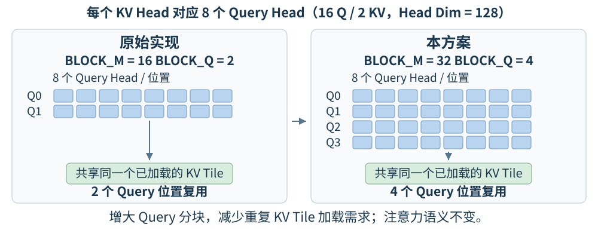
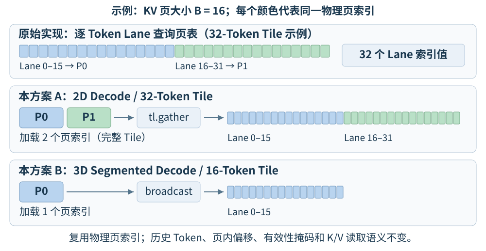

# 技术报告（v14）
## 团队名称: prince22466  


**实验平台：** 天数 BI-V150  
**基础框架：** FlagOS / vLLM-FL

**测试结果与效果分析：** 官方 4K、16K benchmark 进行完整测试，

| 测试场景 | 自测基线（tokens/s） | 本方案（tokens/s） | 绝对增益（tokens/s） | 相对增益 |
|---|---:|---:|---:|---:|
| 4K | 1,881.95 | 2,752.60 | TBD | **+%** |
| 16K | 861.88 | 1,890.18 | TBD | **+%** |

**精度测试：**  达到 MATH-500 Level 3 的 95% 门槛。


### 方案设计思路

#### 1. 性能瓶颈（优化前）

- **Prefill 阶段：** 长序列注意力涉及大量 Q/K/V 分块计算。原有 GQA（Grouped-Query Attention，分组查询注意力）分块方式对同一 KV Tile 的复用不足，存在重复加载和分块执行开销。
- **Decode 阶段：** 每次生成一个 Token 时，需要访问历史 KV Cache。原有分页 KV 地址计算按 Token Lane 加载页表索引，同一物理页内存在重复的索引查询和地址计算。
- **长上下文服务：** 16K 高并发场景还受到 KV Cache 容量、请求排队、抢占及 Prefill/Decode 干扰的共同影响，因此不能仅依据单个算子的加速比判断最终服务吞吐量。

#### 2. 方案选择

本方案的核心思路是**提高注意力算子的数据复用效率，减少长上下文推理中的重复访存与地址计算**。针对 Prefill 和 Decode 的不同特点，在同一个 Triton Unified Attention 算子中实施两项优化：

| 推理阶段 | 主要问题 | 优化策略 |
|---|---|---|
| Prefill | 不同 Query 分块重复读取 KV Tile | 扩大 Query 分块，提高 KV Tile 复用；采用单级流水线控制资源开销 |
| Pure Decode | 同一 KV 页内的 Token 重复查询物理页索引 | 按页加载索引，在 Tile 内广播或 Gather 复用 |

优化以原生 Triton Attention 为基础，仅改变算子内部的执行方式，不改变注意力计算范围、模型结构或服务调度策略。

### 算法原理及优化策略

#### 1. 基础算法：GQA 与分页 KV Cache

MiniCPM5-2B 的目标 GQA（分组查询注意力）配置为 16 个 Query Head、2 个 KV Head，Head Dimension 为 128。因此，每个 KV Head 可供 8 个 Query Head 共享。

对于单个 Query Head，标准缩放点积注意力为：

$$
O = \operatorname{softmax}\left(\frac{QK^{\mathsf T}}{\sqrt{d}}+M\right)V
$$

其中 $d$ 为 Head Dimension，$M$ 为注意力掩码。不同 Query Head 共享 K/V 数据，但分别计算注意力权重及输出。实际实现沿用 vLLM 0.24.0 的分块在线 Softmax 算法及缩放系数。

vLLM 使用分页 KV Cache。对于某条序列的逻辑 Token 位置 $t$ 和页大小 $B$，其物理页索引 $p(t)$ 与页内偏移 $r(t)$ 为：

$$
p(t)=\operatorname{BlockTable}\left[\left\lfloor t/B\right\rfloor\right],
\qquad r(t)=t\bmod B
$$

下面两项优化分别针对 K/V 数据的分块复用和物理页索引的复用，保持上述计算目标和页映射不变。

#### 2. Prefill：扩大 Query 分块，提高 KV Tile 复用

**优化原理。** 原有算子在一个 KV Head 对应 8 个 Query Head 时，使用 `BLOCK_M = 16`，即每个 Query Block 处理 2 个 Query 位置。v14 将 `BLOCK_M` 增至 64，使同一计算块处理 8 个 Query 位置。

$$
\mathrm{BLOCK\_Q}=\frac{\mathrm{BLOCK\_M}}{8}
\qquad (2\rightarrow8)
$$

| 参数 | 优化前 | 本方案（满足特化条件） |
|---|---:|---:|
| `BLOCK_M`（Query 行数） | 16 | 64 |
| `BLOCK_Q`（Query 位置数） | 2 | 8 |
| KV Tile 大小（Token 数） | 32 | 32 |
| `num_stages` | Triton 默认 | 1 |
| `num_warps` | Triton 默认 | Triton 默认 |



**预期收益。** 更多 Query 位置可共享同一已加载的 KV Tile，减少长序列所需的 Query Block 数量和重复加载 K/V 的需求。完整分块的复用位置数由 2 增至 8，即 4 倍的理论复用能力，而非 4 倍实测吞吐量。

**流水线配置。** 更大的 Query 分块也会增加累加器和中间状态的规模。因此，v14 显式设置 `launch_num_stages = 1`（传入 Triton 的 `num_stages = 1`），以控制多级流水线可能带来的寄存器及片上资源压力。KV Tile 大小不变，`num_warps` 仍由 Triton 默认决定。实际收益取决于编译器、硬件及输入形状。

**启用条件。** `optimize_prefill_gqa` 必须同时满足：

- `max_seqlen_q > 1`：批次含多 Token Query，包括符合条件的 Prefill 和混合批次。
- Q/K/V 均为 BF16，16 个 Query Head、2 个 KV Head，Head Dimension 为 128。
- 非量化 KV Cache（`KVQuantMode.NONE`），且不使用 Tensor Descriptor（`use_td=False`）。
- 使用标量因果注意力，不使用逐序列因果模式；`sliding_window_val == 0`、`chunk_lookback == -1`。
- 未启用多模态前缀、ALiBi 或 QQ Bias，且 `sinks is None`、`softcap == 0`、`output_scale is None`。

不满足条件时，沿用原有分块和启动参数选择逻辑。

#### 3. Decode：复用分页 KV 物理页索引

**优化原理。** 原有算子为每个 Token Lane 查询页表。同一物理页中的多个 Token 共享同一页索引，因此无须分别加载该索引。v14 在统一 Kernel 中加入编译期参数 `DECODE_PAGE_LOOKUP`，按页加载索引后分配给对应的 Token Lane。

设 KV 页大小为 $B$、Tile 大小为 $T$。在二者满足整倍数对齐关系时：

- $B\ge T$：Tile 位于一个物理页内，只加载一次页索引，并使用 `tl.broadcast_to` 广播。
- $T>B$：Tile 覆盖多个整页，加载各页索引，再用 `tl.gather` 按 Lane 所属页分配索引。末尾页通过 `page_start + page_offs < ceil(seq_len / BLOCK_SIZE)` 掩码保护。

以 16-Token KV 页和目标 BF16、无 Sliding Window 配置为例：

| 执行路径 | KV Tile | 优化前  逻辑加载元素数 | 本方案 逻辑加载元素数 | 复用方式 |
|---|---:|---:|---:|---|
| 2D Decode | 32 | 32 | 2 | Gather |
| 3D Segmented Decode | 16 | 16 | 1 | Broadcast |



**预期收益。** 对于完整 Tile，上例的页表逻辑加载元素数降至原来的 1/16。此比例不代表实际显存事务数或吞吐量加速比；编译器访存合并及缓存命中仍会影响实际收益。各 Token 的物理页、页内偏移、有效性掩码及 K/V 读取语义保持不变。

**启用条件。** `decode_page_lookup` 必须同时满足：

- `max_seqlen_q == 1`：Pure Decode 批次。
- Q/K/V 均为 BF16，16 个 Query Head、2 个 KV Head，Head Dimension 为 128。
- KV 页大小为正的 2 的幂，且页大小与 Tile 大小中较大者为较小者的整数倍。
- 非量化 KV Cache（`KVQuantMode.NONE`），不使用 Tensor Descriptor。

该优化不改变 Decode 的 Query 分块、Tile 大小或流水线配置。2D/3D 路径仍由原有 `use_3d` 逻辑选择：3D 需要分段参数与三个 Softmax 中间缓冲区均存在，序列数量不超过阈值，`max_seqlen_q <= 1`，且未启用 Batch Invariance。其他配置的 Tile 大小仍遵循原有选择规则，例如 Gemma3 Sliding Window 特化。

不满足 Decode 特化条件时，Kernel 保留原有逐 Token 页表查询路径。

#### 4. 两项优化如何协同

| 批次类型 | 执行方式（满足相应特化条件时） |
|---|---|
| Prefill 或 Prefill/Decode 混合批次 | 扩大 Query 分块，采用单级流水线 |
| Pure Decode 批次 | 复用物理页索引 |
| 不满足任一特化条件 | 同一共享 Kernel 中的原有执行逻辑 |

两项优化在单次算子调用中互斥，由批次最大 Query 长度及其他资格条件决定；混合批次不会单独启用 Pure Decode 页表特化。原有 Query 有效性掩码继续保护其中的单 Token 请求。

**技术贡献**是通过两种复用机制减少重复工作，而非缩短注意力范围或替换为近似算法。原有在线 Softmax、因果掩码和分段归约算法保持不变；浮点分块执行不保证逐位一致，精度仍须通过功能测试及 MATH-500 验证。

### 实现架构

#### 1. 整体架构

v14 将优化集成至 `vllm-plugin-FL` 的共享 Triton Attention 路径。框架先按原有 Dispatch 规则选择 Backend；仅当返回原生 `TritonAttentionBackend`，且 `use_mla`、`use_sparse` 均为 False 时，映射至优化后的实现。

```text
vllm serve
    |
    v
PlatformFL.get_attn_backend_cls
    |
    v
原有 call_op("attention_backend")
    |
    |-- 其他 Backend，或 MLA / sparse
    |       --> 保持原选择
    |
    |-- 原生 dense Triton Backend
            |
            v
        OptimizedTritonAttentionBackend / Impl
            |
            v
        unified_attention
            |
            |-- Prefill 特化：BLOCK_M=64，num_stages=1
            |-- Decode 特化：按页加载索引并复用
            |-- 其他配置：原有 Kernel 分支
```

适配层继承原生 Triton Backend 和 Impl，复用 Attention Metadata、KV Cache 更新机制及接口，仅将分页注意力的调用接入优化后的统一算子。Encoder Attention 仍使用继承的原有处理方法。

**设备无关性。** 两项新增特化及其接入方式不含 GPU 厂商或设备能力门控，但保留上游已有的设备特定分支（如 Head Dimension 为 256 的特化）。因此，设备无关指优化不受新增厂商门控限制，不代表已在其他 GPU 上验证性能或兼容性。

#### 2. 核心代码及职责

相对于 优化前，生产代码仅涉及以下三个文件（路径相对于 `vllm-plugin-FL/`）：

| 文件 | 变化 | 职责 |
|---|---|---|
| `vllm_fl/platform.py` | 修改 | 保留原有 Dispatch，映射选中的原生 dense Triton Backend |
| `vllm_fl/dispatch/backends/triton_attention.py` | 新增 | 共享 Backend / Impl 适配层，调用统一注意力算子 |
| `vllm_fl/dispatch/backends/triton_unified_attention.py` | 新增 | Prefill 分块与单级流水线；Decode 页表索引复用 |

`flaggems/flaggems.py`、整个 `FlagGems/` 源码树、GEMM / Linear、RMSNorm、KV Cache 写入算子及调度策略均未修改。官方 benchmark 与模型、服务启动参数也保持不变。

#### 3. 功能测试与运行流程

本方案提供以下三个功能测试文件，均位于 `vllm-plugin-FL/tests/functional_tests/`：

| 测试文件 | 验证内容 |
|---|---|
| `test_biv150_attention.py` | 模拟不同厂商及 Dispatch 返回路径，检查 Backend 映射和 Adapter 绑定；GPU 对照测试验证 BF16 GQA 输出及 Prefill/Decode 特化参数 |
| `test_biv150_decode.py` | 对照原生 Triton，检查 2D/3D Decode、乱序物理页、未对齐尾页及特化回退 |
| `test_biv150_mixed_paging.py` | 检查混合批次和乱序分页；目标形状无 Sliding Window 时验证 `BLOCK_M=64`、`num_stages=1`，启用 Sliding Window 时验证 `BLOCK_M=16` 且不显式设置 `num_stages` |

独立算子测试在导入 Triton 模块前调用 `PlatformFL.pre_register_and_update()`，保留原有平台兼容性初始化流程。厂商模拟测试不等同于跨设备 GPU 实测；与原生 Triton 的数值对照也不替代独立数学参考验证及官方吞吐量、精度测试。

### **其他说明**

#### 1. 赛事合规性

本方案

- 未修改超参数开启量化或投机采样。
- 未修改官方 benchmark 脚本、测试场景、模型权重或规定的服务启动参数。
- 未切换至未经优化的算子或删除框架主要算子选择逻辑获得性能提升；保留原有优先级及回退机制。
- 未直接合并 FlagOS 推理框架最新分支获得性能提升。

#### 2. 其他硬件平台

由于测试过程中遇到错误，本优化方案未能在沐曦-曦云 C500（显存 64 GB）上完成性能验证。
